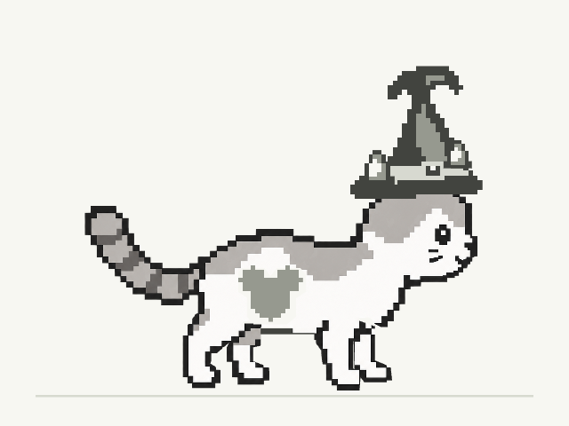
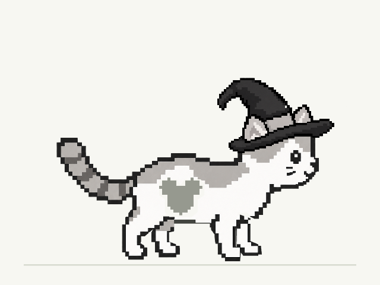

# Task 8 verification: approved witch-hat application

Date: 2026-10-22. Branch: `codex/v1-nine-item-review`, based on merged main
`a00836f` (PR #9). The owner instructed proceeding with the saved witch hat while
deferring the other item edits. This record completes that application scope;
full nine-item visual acceptance remains pending. The existing bowler approval
is preserved. Crown, heels, runners, sandals, Mickey, star and skull correction
reviews remain pending; automated rendering checks do not establish owner approval.

## Exact inputs and application

The original pair remains under `concepts/luna/wardrobe-review/` with its original
download filenames:

| Input | SHA-256 |
| --- | --- |
| `luna-wardrobe-fit (2).json` | `422435755b3ef3ba83e1685e834ba8628a1ef0b390468325218fe5e976748d18` |
| `luna-wardrobe-preview (3).png` | `730454d43d3446c7f5399fb833bed89d055158b94d7bc611eeff3c3a88b66d58` |

The version 2 JSON embeds the approved transparent witch PNG. The application
command validated the complete pair and every supplied fit before writing. Only
`witch` changed: grid art at x=806, y=156, scale=1 became PNG art at **x=635,
y=209, scale=0.40**. All eight other item settings/artwork, rewards, attachment
rules, IDs and defaults are unchanged. The active PNG SHA-256 is
`1574333b5e01a3180a3e53193f85a03bbf71c87f237168dfd86b6d5f8034e12f`;
its full hash is part of its catalog filename. Its bytes equal the embedded
input exactly. No extraction, redraw, resampling or recompression was performed.

The server was stopped for application and restarted afterward. Commands from
the repository root, with Node 22+:

```sh
node scripts/apply-wardrobe-review.mjs \
  --review 'concepts/luna/wardrobe-review/luna-wardrobe-fit (2).json' \
  --preview 'concepts/luna/wardrobe-review/luna-wardrobe-preview (3).png' --dry-run
node scripts/apply-wardrobe-review.mjs \
  --review 'concepts/luna/wardrobe-review/luna-wardrobe-fit (2).json' \
  --preview 'concepts/luna/wardrobe-review/luna-wardrobe-preview (3).png' --apply
```

[Dry-run](v1-task8/dry-run.json), [application](v1-task8/application.json) and
[repeat application](v1-task8/repeat.json) stdout are retained verbatim. Repeating
the explicit `--apply` reports no changed items and an empty file list, retaining
the archive and offline inventory bytes.

The command archived exact input copies and its original report under
`concepts/luna/applied-reviews/6237feec4702c5c2bcaf8005c764084d6e889969a0a5a8cf8e2772783ff20191/`.
The report retains the retired witch grid rows/fit. Prior bowler art and review
files remain untouched. Unapproved crown candidate files in the working tree
are excluded from this change.

## Saved pose and movement

The saved outfit is witch / bare paws / Mickey, motion `ready`, playback speed 1,
height 0, neutral standing pose without blinking. The full pose remains in the
archived JSON. Reproduction uses the actual game renderer and attachment rig,
640×480 enlarged and 150×110 native canvases, device scale 1, and nearest-neighbor
image scaling.

- [Pose results](v1-task8/pose.json): imported review and applied rendering reproduce
  the owner's decoded PNG pixels exactly at `/` and `/luna_game/`.
- [Movement results](v1-task8/movement.json): review overrides equal applied catalog
  rendering for all 48 outfits in stand, walk, takeoff, apex, reach, landing and
  blink poses at both sizes: 672 exact frame comparisons per URL prefix.
- [Enlarged movement sheet](v1-task8/movement-enlarged.png) and
  [native movement sheet](v1-task8/movement-native.png) show the saved outfit.
  Cells read left to right: stand, walk, takeoff; apex, reach, landing; blink.

The initial software-Canvas reproduction differed from the owner's PNG because
the owner saved with Chrome's default Canvas backend. Matching that backend
reproduces the owner PNG exactly. Movement comparisons use software Canvas for
both sides, as in the existing project parity checks; no cross-backend tolerance
or ignored character pixels are used. Chrome version: 156.0.8078.47.

Reproduce these checks with Playwright, pngjs and Google Chrome available to Node:

```sh
node docs/verification/v1-task8/check-review.mjs pose
node docs/verification/v1-task8/check-review.mjs movement
```

These commands create temporary output folders and disposable browser contexts.
An optional final argument selects an output folder. They import the archived
review, use shared review adapters, and leave active assets and the owner's
browser profile untouched. The saved JSON continues to contain all nine fits.

At the same saved pose, before application (archived grid) and after application:




## Regression and offline evidence

Baseline on 2026-10-17 and again before application on 2026-10-22: 171 Node tests
passed, no pre-existing game-test failures. Local runtime: bundled Node v24.19.0;
CI uses Node 22. The shell has no `node` on PATH, so local commands used the
bundled absolute executable. Browser scripts used bundled Playwright/pngjs via
`NODE_PATH`; no project dependencies were installed.

After application, 26 tests exposed fixture assumptions: synthetic reviews still
requested retired grid art, grid corruptions targeted the witch item by array
index, and loader assertions expected exactly one PNG. Fixtures now use shared
applied-fit adapters for current application tests, select actual grid artwork
for grid validation, and derive request counts from catalog PNG paths. The old
catalog is frozen in `tests/fixtures/luna-v1/catalog.json` (exact `a00836f` bytes)
for historical v2 tests. A historical review requiring retired witch grid art
still fails explicitly; legacy bowler import retains the current witch default.
The runtime contract was not relaxed.

Final checks:

```sh
node --test tests/*.test.js
node scripts/generate-offline-assets.mjs --check
node scripts/check-studio-review.mjs
node scripts/check-review-application.mjs
node scripts/check-wardrobe-saves.mjs
node scripts/check-offline-browser.mjs
```

172 Node tests passed. Studio checks cover all nine uploads, exact embedded bytes,
imports/exports, resets, concurrent/invalid inputs, saved pose and save isolation.
Disposable application checks cover exact PNG transfer, seven movement poses,
idempotence and save preservation at root/subpath. Save checks cover migration,
reload, best distance, unlocks, storage errors and the current-run outfit snapshot.
The saved-review checker also preserves a fixture best distance of 1183, earned
rewards and equipment through import/render/reload; Store selection persists the
witch while retaining shoes and mark independently.

The application transaction generated the 28-resource offline inventory. Check
passed with identity
`ec6691ad50f5fd450d3262e56d2904dac1cc6e2a0bc1687510819672152d99ba`.
The witch PNG is included; studio, concepts and review evidence remain excluded.
No manual worker version/list change was needed.

Installed-worker Chrome checks passed at root/subpath: actual v19 worker upgrade,
old clients waiting before activation, browser-process restart while the server
is unavailable, all active PNGs including witch fetched offline with exact
hashes, saved progress/equipment, interrupted updates/recovery, failed first
install and localhost isolation. The v19 fixture uses the frozen previous grid
catalog to represent that worker's manual asset generation. The generated worker
loads the new catalog and raster witch together. Test-only secure loopback origins
exercise installed workers; normal localhost retains its cache bypass.

Real Android installation/offline launch remains unverified and belongs to
Task 9. No merge, deployment, publication, gameplay or control change is included.
